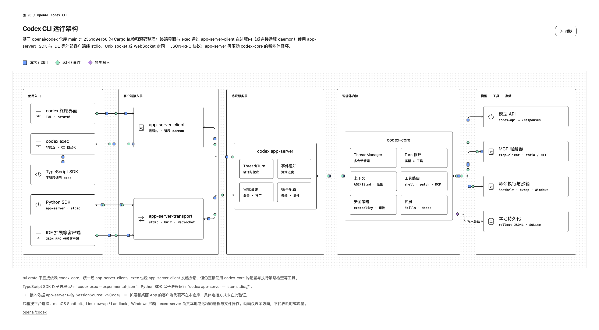
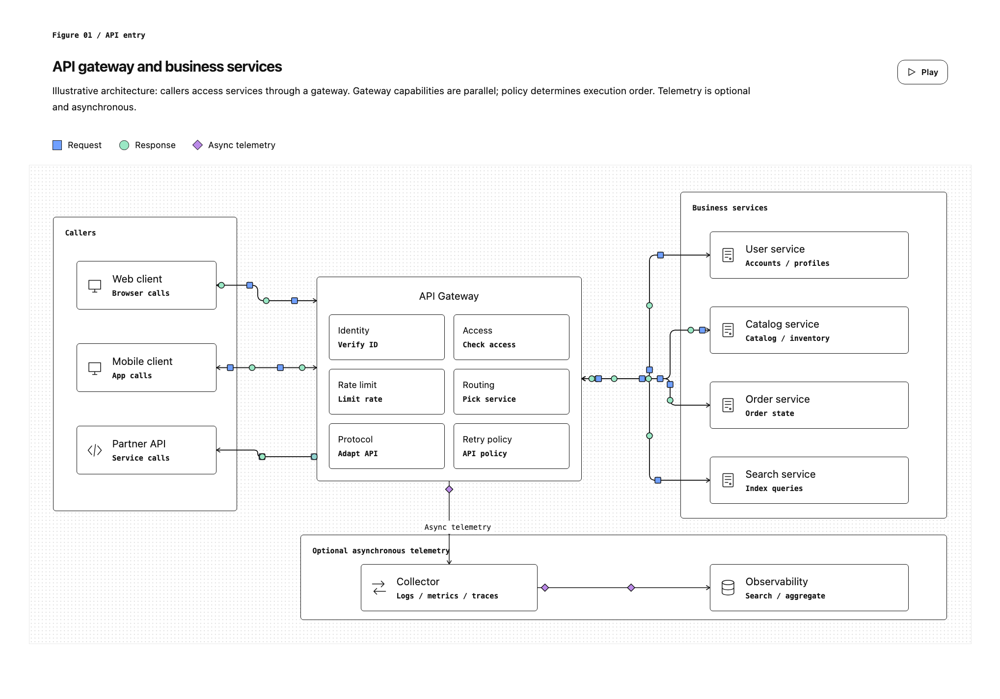
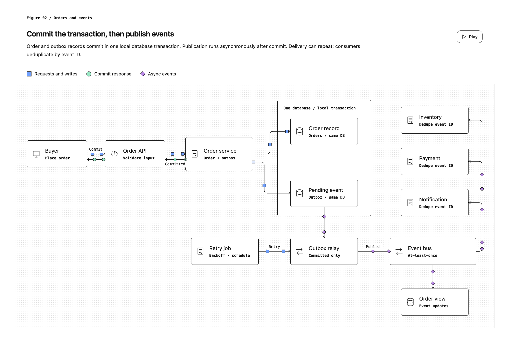
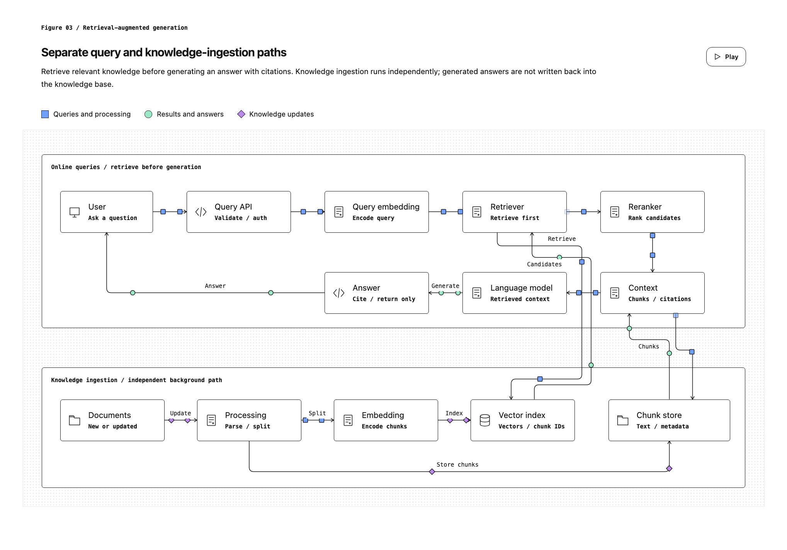
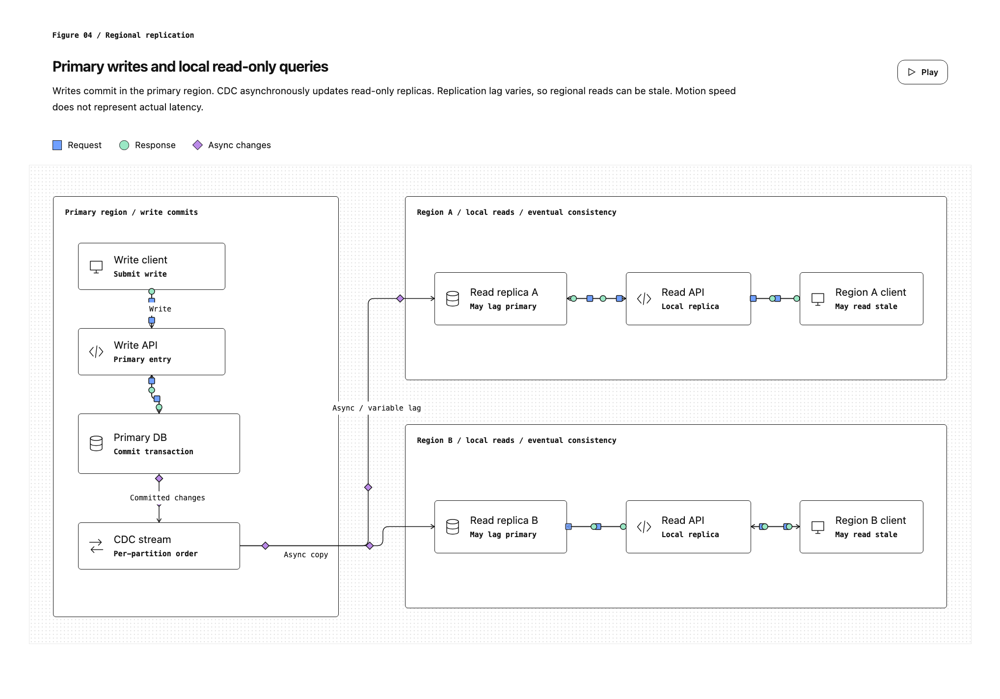
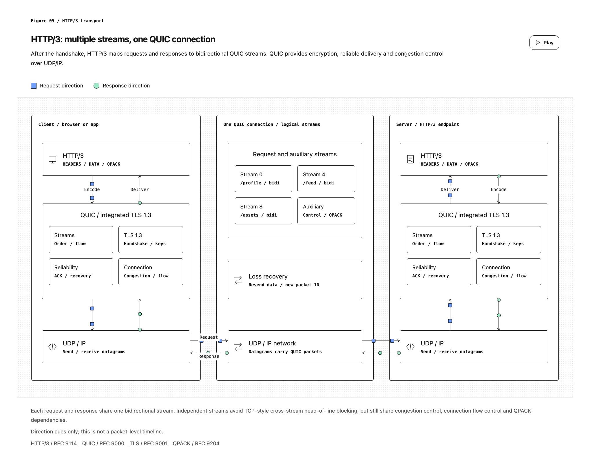

# Editorial Diagrams

English | [简体中文](README.zh-CN.md)

An agent skill that turns a plain-language request into a precise, editable, animated technical diagram — the kind of figure you would find inside a well-edited engineering article.

**Live example:** [Codex CLI architecture (Chinese)](https://codex-architecture-site.vercel.app/), drawn by the skill from the `openai/codex` source tree.

[](https://codex-architecture-site.vercel.app/)

## What "editorial" means here

"Editorial" refers to the figures that accompany articles in engineering blogs and publications: a figure label, a heading, a one-paragraph explanation, a legend and source notes, all framing a calm black-on-white diagram. The skill produces that kind of figure rather than a whiteboard sketch or an auto-laid-out graph:

- white surface with a subtle dot grid, 1px dark borders and 4px card corners;
- aligned cards and groups, orthogonal connectors with arrowheads;
- small animated markers that show direction — squares for requests, circles for responses, diamonds for asynchronous changes;
- a labeled play/pause control, a legend and notes for assumptions and sources.

## Install

With [skills.sh](https://skills.sh):

```bash
npx skills add wyh0626/editorial-diagrams
```

Install globally for a specific agent:

```bash
npx skills add wyh0626/editorial-diagrams -g -a claude-code
```

```bash
npx skills add wyh0626/editorial-diagrams -g -a codex
```

Manual install: copy [`skills/editorial-diagrams`](skills/editorial-diagrams) into your agent's skills directory, for example `~/.claude/skills/editorial-diagrams`.

## Use

Ask your agent in any language:

```text
/editorial-diagrams Draw the architecture of this repository
```

```text
Use editorial-diagrams to show how a request flows through our API gateway
```

The agent reads the code or the description, plans the layout, writes a JSON configuration, renders it and checks the result in a browser. You get:

| File | Purpose |
| --- | --- |
| `diagram.json` | Editable source: nodes, groups, edges, text |
| `diagram.html` | Self-contained interactive page (inline CSS and JS, no network requests) |
| `diagram.png` | Optional preview, when the host can take browser screenshots |

The generated page follows the conversation's language, including button captions and accessibility labels.

## Render manually

The renderer needs Python 3.8+ and nothing else.

```bash
python3 skills/editorial-diagrams/scripts/render.py --data skills/editorial-diagrams/examples/01-api-gateway.json --output out/api-gateway.html
```

- `--instance <id>` sets a stable root element ID.
- `--fragment` writes an embeddable fragment instead of a full page.

The renderer validates geometry before writing: board bounds, duplicate IDs, overlapping nodes, orthogonal segments, endpoints attached to node borders and connectors that pass through unrelated nodes. It cannot measure text, so check the page in a browser:

| Query | Effect |
| --- | --- |
| `?time=2.4` | Freeze the animation at 2.4 s for repeatable screenshots |
| `?scroll=500` | Scroll the board horizontally |
| `?check=1` | Outline card labels that overflow, and report the count in `data-overflow` |

The configuration format is documented in [`references/graph-format.md`](skills/editorial-diagrams/references/graph-format.md).

## Examples

| | |
| --- | --- |
| [](skills/editorial-diagrams/examples/01-api-gateway.json) | [](skills/editorial-diagrams/examples/02-order-events.json) |
| API gateway and business services | Commit the transaction, then publish events |
| [](skills/editorial-diagrams/examples/03-rag.json) | [](skills/editorial-diagrams/examples/04-regional-replication.json) |
| Separate query and ingestion paths | Primary writes, local read-only queries |
| [](skills/editorial-diagrams/examples/05-http3.json) | [](skills/editorial-diagrams/examples/06-codex-cli-zh-CN.json) |
| HTTP/3 streams over one QUIC connection | Codex CLI architecture (Simplified Chinese) |

The examples are starting points for topology, not templates to fill in.

## Repository layout

```text
skills/editorial-diagrams/
├── SKILL.md                  # Instructions the agent follows
├── agents/openai.yaml        # Display metadata for Codex
├── assets/                   # CSS, icon geometry, playback script
├── examples/                 # Example JSON configurations
├── references/graph-format.md
└── scripts/render.py         # Standard-library renderer and validator
docs/images/                  # README previews
```

## Notes

- Animation shows direction only. It does not represent latency, throughput or packet counts.
- The skill uses system fonts and simple original geometric icons. It contains no extracted website code, proprietary fonts or brand assets.
- This is an independent community project. It is not affiliated with or endorsed by OpenAI or any publication whose figures inspired the visual style. The Codex example describes the public `openai/codex` repository.

## License

[MIT](LICENSE)
