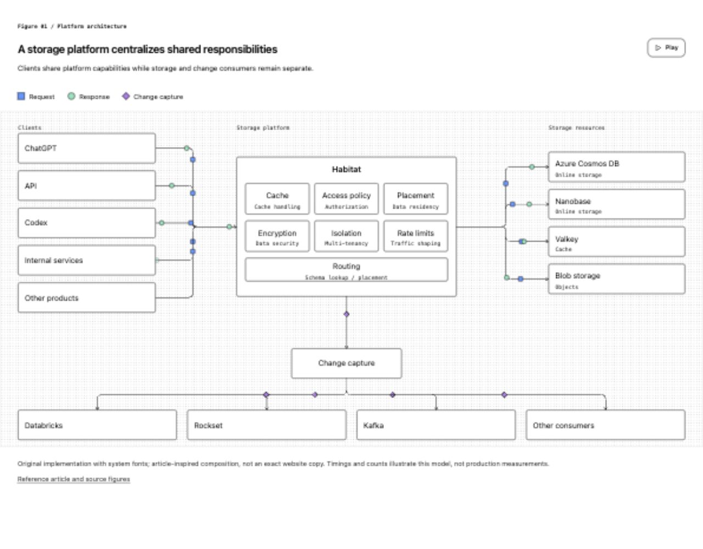
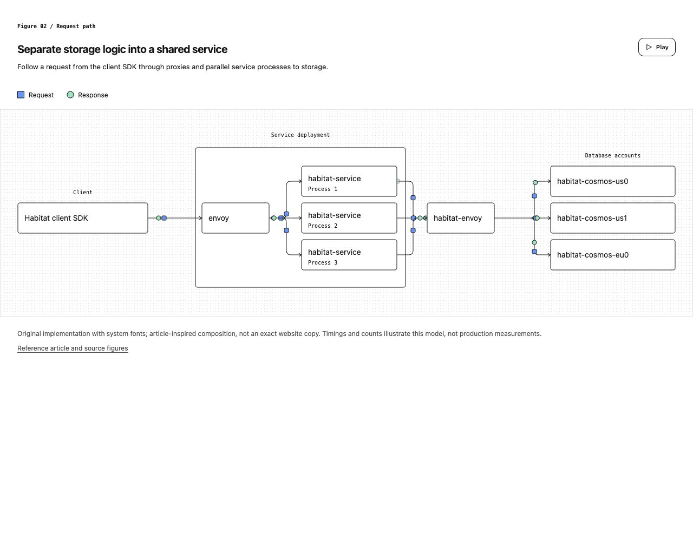
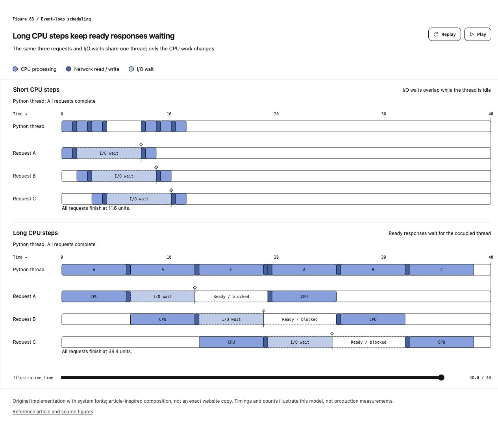
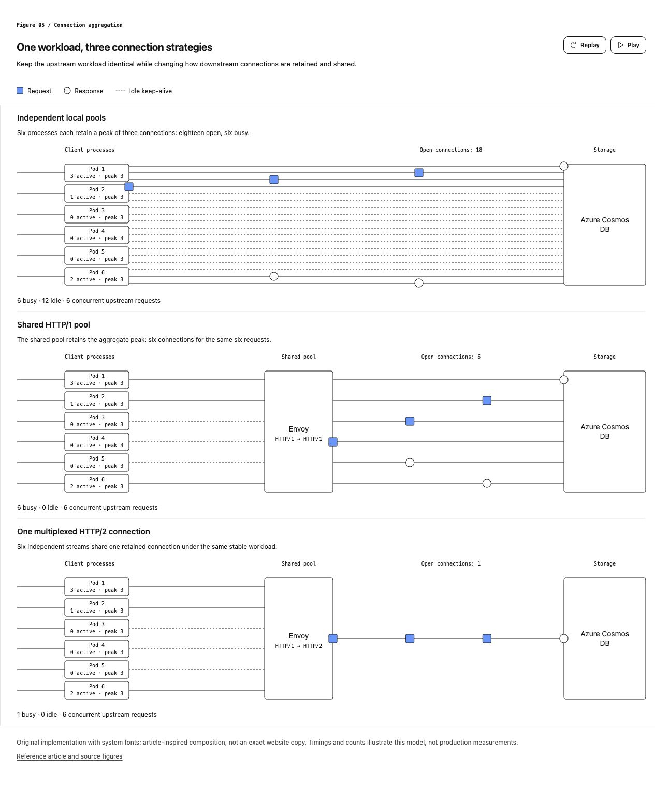
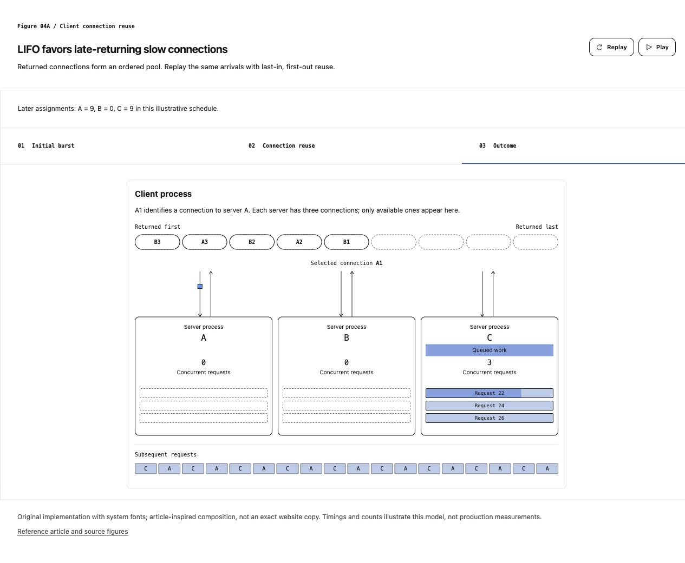
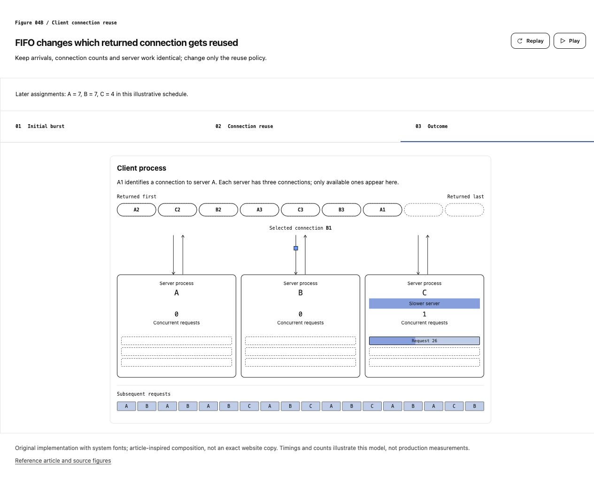

# Editorial Diagrams

[English](README.md) | 简体中文

一个根据自然语言需求，自动选择并改编工程博客配图案例的 Agent Skill。[OpenAI 存储工程文章](https://openai.com/zh-Hans-CN/index/scaling-storage-one-billion-users-part-one/)中的六张图组成五类可复用构图。AI 先判断要解释什么，再选择案例、替换对象与文案、调整模型参数。

## 案例库

| 读者需要理解什么 | 选择的构图 | 原文图号 |
| --- | --- | --- |
| 组件、职责与依赖关系 | 平台架构 | 01 |
| 一次操作经过哪些组件 | 带分支的请求链路 | 02 |
| 处理、等待和阻塞分别花了多久 | 共用时间尺度的双场景时间轴 | 03 |
| 资源归还顺序、选择策略及负载变化 | 连接池复用，LIFO / FIFO | 04A / 04B |
| 同样的上游负载为何只需更少连接 | 三层连接汇聚对比 | 05 |

用户描述想法，AI 自行选择案例。例如，解释请求经过哪里选图 02，解释就绪响应为何仍需等待选图 03，解释多路复用如何减少连接选图 05。提到“连接”不会自动变成流程图。

| | |
| --- | --- |
| [](skills/editorial-diagrams/examples/blog/01-architecture.json) | [](skills/editorial-diagrams/examples/blog/02-request-flow.json) |
| 图 01 · 平台架构 | 图 02 · 请求链路 |
| [](skills/editorial-diagrams/examples/blog/03-timeline.json) | [](skills/editorial-diagrams/examples/blog/05-aggregation.json) |
| 图 03 · 线程调度与就绪等待 | 图 05 · 独立池、共享池、多路复用 |
| [](skills/editorial-diagrams/examples/blog/04a-pool-lifo.json) | [](skills/editorial-diagrams/examples/blog/04b-pool-fifo.json) |
| 图 04A · 最近归还的连接优先 | 图 04B · 最早归还的连接优先 |

这些预览使用原创实现和系统字体，遵循原文的构图与示意行为，不承诺与官网逐像素一致。

## 安装

使用 [skills.sh](https://skills.sh)：

```bash
npx skills add wyh0626/editorial-diagrams
```

或全局安装到指定 Agent：

```bash
npx skills add wyh0626/editorial-diagrams -g -a claude-code
npx skills add wyh0626/editorial-diagrams -g -a codex
```

手动安装：把 [`skills/editorial-diagrams`](skills/editorial-diagrams) 复制到 Agent 的 skills 目录，例如 `~/.claude/skills/editorial-diagrams` 或 `~/.codex/skills/editorial-diagrams`。

## 使用

```text
用 editorial-diagrams 解释：事件循环线程做了太久的 CPU 处理，为什么已经就绪的响应还要等待？
```

```text
用 editorial-diagrams 比较独立连接池、代理共享连接池和多路复用，保持请求负载相同。
```

AI 会选择最合适的案例，复制可编辑 JSON，调整内容与参数，渲染后在浏览器中检查。改编时保留该案例的主要结构。参数无法表达必要变化时，仍可使用自定义场景接口。

生成图的标题、图例、按钮、内部标签和无障碍名称跟随用户指定语言或对话语言；skill 本体与编写参考保持英文。

产出为可编辑的 `diagram.json`、自包含的 `diagram.html`，以及可选的浏览器预览。页面不依赖外部字体、库或网络请求，只有自定义改编才需要额外场景文件。

## 渲染案例

只需要 Python 3.8+：

```bash
python3 skills/editorial-diagrams/scripts/render.py --data skills/editorial-diagrams/examples/blog/05-aggregation.json --output out/aggregation.html
```

JSON 中设置 `pattern`、`content` 和适用的 `model` 参数，渲染器计算布局。两种连接池策略共用相同请求到达时间与服务端工作量；时间轴共用同一尺度；连接汇聚各层共用相同上游负载。

- `--instance <id>` 指定固定根元素 ID；`--fragment` 输出可嵌入片段。
- `animated: false` 生成静态图。动态图支持暂停、继续、减少动态效果和不可见时暂停。时间轴与连接池可以定位时间或阶段；连接汇聚默认展示稳态，也可从零重播。
- `?time=...&check=1` 固定截图时刻并报告文字溢出。播放秒数与模型时间的对应关系见各案例说明。
- 请求链路提供手机纵向布局，连接池压缩三列；架构、时间轴和连接汇聚保留几何尺度，通过横向滚动查看。

参考：[案例目录与参数](skills/editorial-diagrams/references/pattern-catalog.md)、[视觉语言](skills/editorial-diagrams/references/visual-language.md)、[自定义场景接口](skills/editorial-diagrams/references/scene-format.md)、[节点连线接口](skills/editorial-diagrams/references/graph-format.md)。

## 开发与验证

```bash
python3 -m unittest discover -s tests -p 'test_*.py' -v
node --test tests/playback.test.cjs
```

测试覆盖渲染与语言约束、线程调度、连接守恒与分配、响应式几何，以及共享播放时钟。外观、文字适配和交互仍需在浏览器中检查。时间与数量为示意参数，不是实际性能保证。

早期节点连线案例保留在 `examples/` 下。另有从公开 `openai/codex` 源码绘制的社区案例：[Codex CLI 运行架构](https://codex-architecture-site.vercel.app/)。

## 许可证与来源

[MIT](LICENSE)。这是独立社区项目，与 OpenAI 无关联，也未获其背书。案例库参考上述文章，由原创 SVG / HTML / CSS / JavaScript 实现，不包含从网站提取的代码、专有字体或品牌素材。
